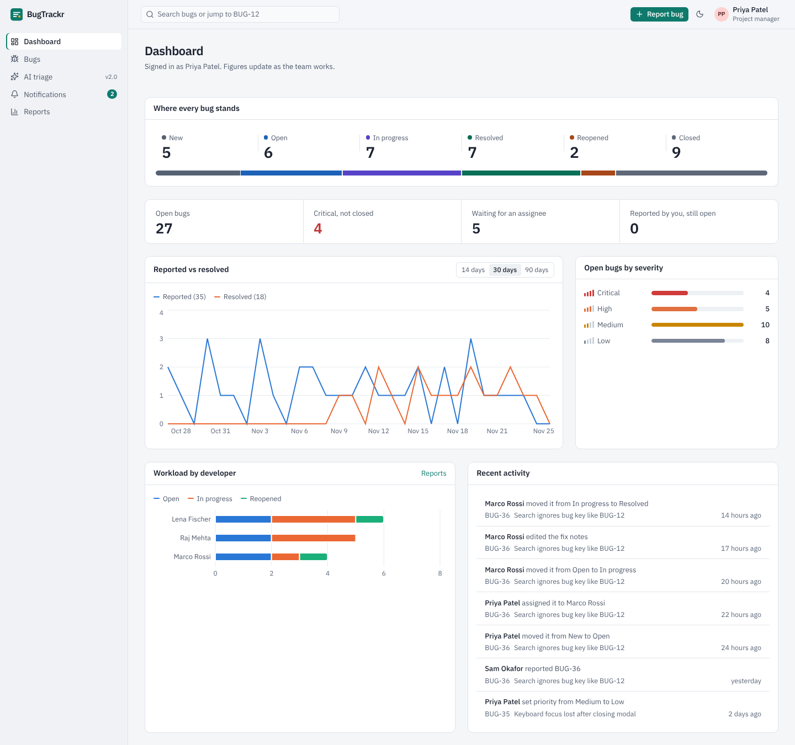
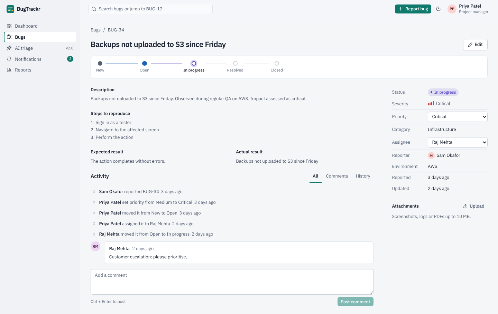
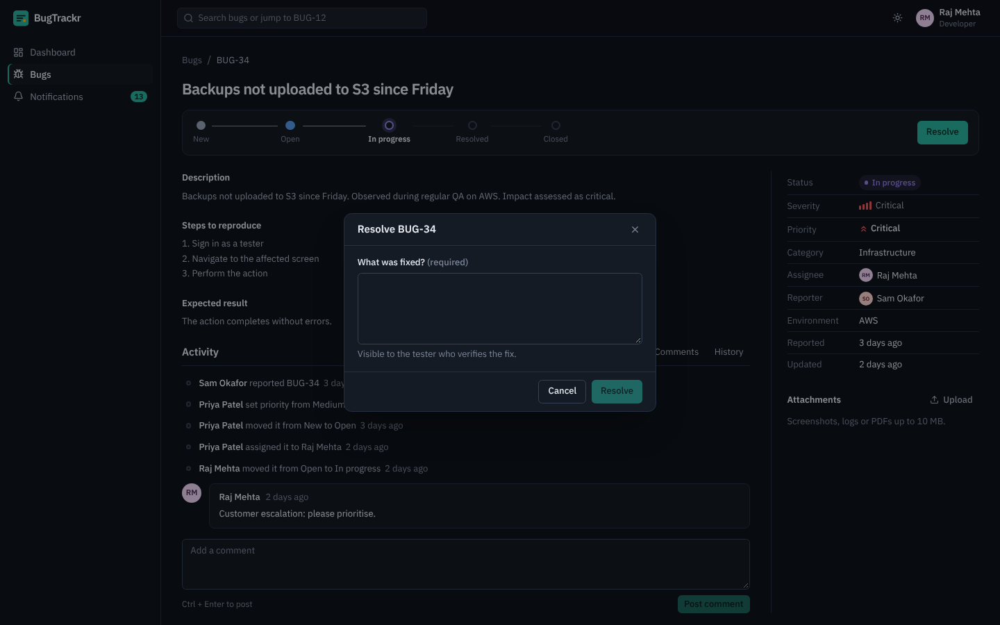
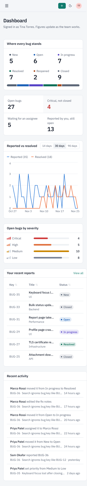

# BugTrackr

**Software Bug Tracking System: From Manual Defect Management to AI-Assisted Decision Support**

A full-stack, role-based defect tracker: React + TypeScript on the front, FastAPI + PostgreSQL behind, with 1,218 automated tests across seven layers. Version 1.0 delivers the complete manual workflow; version 2.0 adds AI suggestions that people accept or override.



| | |
|---|---|
| **Release** | **v1.0.0** — [release notes](docs/releases/v1.0.md) · [changelog](CHANGELOG.md) |
| **Tests** | 1,218 passing: 988 backend (99% coverage) · 49 frontend unit · 181 Playwright (API contract, functional, integration, production build, accessibility, visual) |
| **Stack** | React 19 · TypeScript · Tailwind CSS 4 · TanStack Query · FastAPI · SQLAlchemy 2 · Alembic · PostgreSQL 16 · pytest · Vitest · Playwright |

## Features

- **Four roles, one workflow.** Testers report and verify, project managers triage and assign, developers fix, administrators manage accounts. The backend enforces a [permission matrix](docs/01-requirements-analysis.md#3-permission-matrix-v10) and an 8-transition lifecycle; the UI only offers what each person can do.
- **Complete audit trail.** Every change is recorded with actor, old and new value, and time. Comments and attachments sit alongside the history.
- **Find anything.** Combinable filters, keyword or `BUG-12` search, sorting by business rank (Critical → Low), and shareable URLs.
- **Stay informed.** Notifications for assignments, status changes, comments and reopened bugs. A dashboard with the lifecycle rail, trends, severity and workload. Reports on closure rate, time to resolve and reopen rate.
- **Production-minded.** JWT with rotating refresh tokens and reuse detection, rate limiting, secure uploads, a documented error contract, structured logs with request IDs, health probes, light and dark themes, WCAG 2.1 AA.

| Bug details | Dark theme, resolve dialog | Mobile |
|---|---|---|
|  |  |  |

## Getting started

**Prerequisites:** Python 3.12+, Node 22+, PostgreSQL 16.

```bash
# 1. Databases (once)
psql -U postgres -c "CREATE USER bugtracker WITH PASSWORD 'devpass' CREATEDB;"
psql -U postgres -c "CREATE DATABASE bugtracker OWNER bugtracker;"
psql -U postgres -c "CREATE DATABASE bugtracker_test OWNER bugtracker;"

# 2. Configuration
cp .env.example backend/.env     # set POSTGRES_PASSWORD=devpass and a JWT_SECRET_KEY

# 3. Install
cd backend && python -m venv .venv && .venv/bin/pip install -r requirements-dev.txt && cd ..
cd frontend && npm ci && cd ..

# 4. Run everything (migrates, creates the admin, loads demo data, starts API + web)
./scripts/dev.sh --seed
```

Open **http://localhost:5173** and sign in with a demo account (password `Demo12345`):

| Role | Email |
|---|---|
| Project manager | `priya.patel@demo.bugtrackr.dev` |
| Tester | `tina.torres@demo.bugtrackr.dev` |
| Developer | `raj.mehta@demo.bugtrackr.dev` |
| Administrator | `ADMIN_EMAIL` / `ADMIN_PASSWORD` from your `.env` |

API documentation: **http://localhost:8000/docs**

## Testing

```bash
cd backend  && .venv/bin/pytest --cov=app            # unit, PostgreSQL integration, API — 988 tests
cd frontend && npm test && npm run typecheck && npm run lint
cd e2e      && npm ci && npx playwright install chromium
createdb -O bugtracker bugtracker_e2e                 # once
cd e2e      && npm test                               # API contract, functional, integration, prod build, a11y
```

The Playwright suite starts its own isolated stack (API :8100 on `bugtracker_e2e`, web :5174/:4174) and rebuilds that database each run. See the [test strategy](docs/10-test-strategy.md), the [traceability matrix](docs/11-traceability-matrix.md) and the [v1.0 test report](docs/test-reports/v1.0-test-report.md).

## Architecture

```
React SPA ──/api──▶ FastAPI routes ─▶ services (rules, workflow, permissions) ─▶ repositories ─▶ PostgreSQL
                                   └─▶ history · notifications · attachments
```

| Document | Contents |
|---|---|
| [01 Requirements](docs/01-requirements-analysis.md) | Roles, permission matrix, lifecycle rules, requirement IDs |
| [02 Architecture](docs/02-architecture.md) | System, backend and frontend design; API conventions |
| [03 Technology stack](docs/03-technology-stack.md) | Versions and rationale |
| [04 Development workflow](docs/04-development-workflow.md) | Branching, commits, release gates |
| [05 Database design](docs/05-database-design.md) | ER diagram, constraints, indexes, migrations |
| [06 Authentication & RBAC](docs/06-authentication-and-rbac.md) | Token model, security controls |
| [07 Bug management](docs/07-bug-management.md) | Workflow errors, editing rules, search, attachments, dashboard |
| [08 Frontend](docs/08-frontend.md) | Design system, session handling, accessibility |
| [09 Integration](docs/09-integration.md) | Deployment modes, session lifecycle, e2e stack |
| [10 Test strategy](docs/10-test-strategy.md) · [11 Traceability](docs/11-traceability-matrix.md) | How quality is assured |
| [Checklist](docs/PROJECT_CHECKLIST.md) | Progress by phase |

## Repository layout

```
backend/    FastAPI app, Alembic migrations, pytest suites, seed scripts
frontend/   React + TypeScript SPA, Vitest unit tests
e2e/        Playwright: Page Objects, fixtures, api / functional / integration / prod-build / a11y / visual
docs/       Requirements, architecture, test strategy, reports, release notes, screenshots
scripts/    dev.sh (one-command local start)
```

## Roadmap

**v2.0, AI-assisted triage:** category, priority and severity suggestions with confidence and explanation; duplicate detection with similarity scores; summaries; developer recommendation. Every suggestion can be overridden and is logged. Also an AI evaluation framework, Docker, GitHub Actions CI/CD, and an AWS deployment guide.
