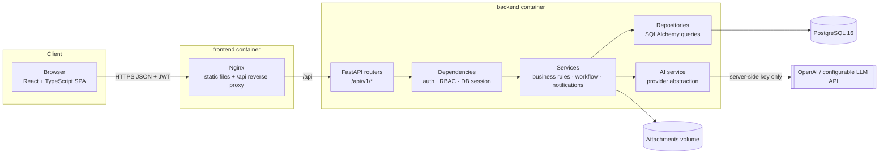
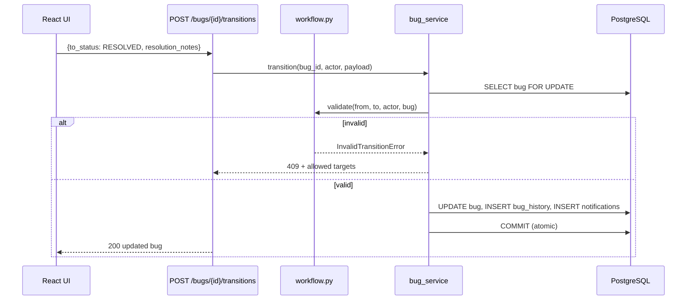
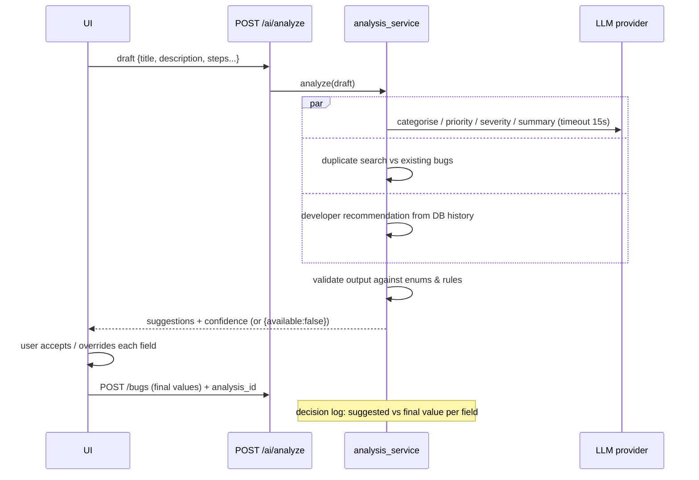

# 02 — System Architecture

## 1. High-level architecture



The browser never talks to the LLM. All AI calls go through the backend, which holds the API key.

## 2. Backend layering

```
HTTP request
   │
   ▼
routes/            ← thin: parse/validate (Pydantic), call a service, map to response schema
   │  Depends(get_current_user), Depends(require_roles(...)), Depends(get_db)
   ▼
services/          ← business logic: permissions, workflow transitions, history, notifications
   │
   ▼
repositories/      ← data access only: queries, filters, pagination (no business rules)
   │
   ▼
models/            ← SQLAlchemy 2.x ORM models (typed `Mapped[...]`)
```

Rules:
- Routes never touch the ORM directly; repositories never raise HTTP errors.
- Services raise domain exceptions (`NotFoundError`, `PermissionDeniedError`, `InvalidTransitionError`, `ValidationError`, `ConflictError`); one exception handler maps them to HTTP codes and the standard error envelope.
- One DB transaction per request; the service commits, so a bug update + its history rows + notifications are atomic.

### Backend module map

```
backend/app/
├── main.py                  app factory, middleware, exception handlers, router mounting
├── core/
│   ├── config.py            pydantic-settings; all config from env
│   ├── security.py          bcrypt hashing, JWT encode/decode
│   ├── logging.py           structured JSON logging + request-id middleware
│   ├── exceptions.py        domain exceptions + handlers
│   └── enums.py             Role, BugStatus, Severity, Priority, Category
├── db/
│   ├── base.py              DeclarativeBase, naming conventions for constraints
│   └── session.py           engine, SessionLocal, get_db dependency
├── models/                  user, role, bug, comment, history, notification, attachment, ai_analysis, refresh_token
├── schemas/                 Pydantic request/response models
├── repositories/            user_repo, bug_repo, comment_repo, history_repo, notification_repo, ...
├── services/
│   ├── auth_service.py
│   ├── user_service.py
│   ├── bug_service.py
│   ├── workflow.py          ← single source of truth for status transitions
│   ├── permissions.py       ← single source of truth for RBAC capability checks
│   ├── history_service.py
│   ├── notification_service.py
│   ├── dashboard_service.py
│   └── attachment_service.py
├── ai/                      (v2.0)
│   ├── providers/base.py    AIProvider protocol
│   ├── providers/openai_provider.py
│   ├── providers/heuristic_provider.py   deterministic, offline
│   ├── similarity.py        duplicate detection (embeddings or TF-IDF cosine)
│   ├── validators.py        validates LLM output against enums/rules
│   └── analysis_service.py  orchestration, timeouts, fallback, logging
└── api/v1/routes/           auth, users, bugs, comments, attachments, history, dashboard, notifications, ai
```

## 3. Frontend architecture

```
frontend/src/
├── api/          typed API client (fetch wrapper with JWT + refresh), one module per resource
├── types/        TypeScript types mirroring backend schemas
├── context/      AuthContext (user, role, tokens), ThemeContext (light/dark)
├── hooks/        TanStack Query hooks: useBugs, useBug, useDashboard, useNotifications ...
├── components/
│   ├── ui/       Button, Input, Select, Badge, Card, Modal, ConfirmDialog, Table, EmptyState, Spinner, Toast
│   ├── layout/   AppShell, Sidebar, Topbar, ProtectedRoute, RoleGuard
│   ├── bugs/     BugTable, BugFilters, StatusBadge, SeverityBadge, BugForm, CommentThread, HistoryTimeline, TransitionMenu
│   └── charts/   StatusDonut, TrendLine, WorkloadBar (Recharts)
├── pages/        Login, Register, Dashboard, BugList, BugCreate, BugDetail, BugEdit, AIAnalysis, Notifications, Users, Reports, Profile
└── lib/          formatting, constants, permission helpers (UI hints only — backend is authoritative)
```

- **Server state:** TanStack Query (caching, refetching, loading/error states).
- **Auth state:** React context; access token in memory, refresh token in `localStorage` (documented trade-off; httpOnly cookie is a hardening option).
- **Routing:** React Router with `ProtectedRoute` and `RoleGuard`. UI hides actions a role can't perform, but **the backend enforces every rule**.
- **Stable test selectors:** interactive elements get `data-testid` attributes for Playwright.

## 4. Key request flows

### 4.1 Status transition (e.g. Developer resolves a bug)



### 4.2 AI-assisted bug submission (v2.0)



If the provider times out or returns invalid data, the response is `{"available": false, "reason": ...}` and the form stays fully manual.

## 5. API design conventions

- Base path `/api/v1`; OpenAPI at `/docs` (Swagger UI) and `/openapi.json`.
- Nouns for resources, sub-resources for relationships: `/bugs/{id}/comments`, `/bugs/{id}/history`, `/bugs/{id}/attachments`.
- State changes that aren't plain field edits are explicit actions: `POST /bugs/{id}/transitions`, `PUT /bugs/{id}/assignee`.
- Status codes: `200` OK, `201` Created, `204` No Content, `400` bad request, `401` unauthenticated, `403` forbidden, `404` not found, `409` conflict (invalid transition / duplicate email), `413` file too large, `415` unsupported file type, `422` validation, `429` rate limited, `503` AI unavailable (only on AI endpoints).
- Pagination: `?page=1&page_size=20` → `{ items, total, page, page_size }`.
- Error envelope: `{ "error": { "code": "INVALID_TRANSITION", "message": "...", "details": {...} } }`.

### Planned endpoint list

| Method | Path | Roles |
|---|---|---|
| POST | `/auth/register` | public |
| POST | `/auth/login` | public |
| POST | `/auth/refresh` | public (refresh token) |
| POST | `/auth/logout` | authenticated |
| GET / PATCH | `/users/me` | authenticated |
| POST | `/users/me/password` | authenticated |
| GET | `/users` | Admin (PM: `?role=DEVELOPER` only, for assignment) |
| PATCH | `/users/{id}/role` | Admin |
| PATCH | `/users/{id}/status` | Admin |
| GET | `/bugs` | authenticated (filters, pagination, sort) |
| POST | `/bugs` | Tester, PM |
| GET | `/bugs/{id}` | authenticated |
| PATCH | `/bugs/{id}` | per §3 of requirements |
| PUT | `/bugs/{id}/assignee` | PM |
| PUT | `/bugs/{id}/priority` | PM |
| POST | `/bugs/{id}/transitions` | per workflow |
| GET | `/bugs/{id}/allowed-transitions` | authenticated (drives UI menu) |
| GET / POST | `/bugs/{id}/comments` | authenticated / Tester, Dev, PM |
| GET | `/bugs/{id}/history` | authenticated |
| GET / POST | `/bugs/{id}/attachments` | authenticated / per §3 |
| GET | `/attachments/{id}/download` | authenticated |
| GET | `/dashboard/summary` · `/dashboard/trends` · `/dashboard/workload` · `/dashboard/activity` | authenticated |
| GET | `/notifications` · `/notifications/unread-count` | authenticated |
| POST | `/notifications/{id}/read` · `/notifications/read-all` | authenticated |
| POST | `/ai/analyze` (v2) | Tester, PM |
| POST | `/ai/categorize` · `/ai/duplicates` · `/ai/recommendations` · `/ai/summarize` (v2) | Tester, PM, Dev (read) |
| POST | `/ai/analyses/{id}/decisions` (v2) | Tester, PM |
| GET | `/health` · `/health/ready` | public |

## 6. Database (overview — detailed in Phase 2)

Tables: `roles`, `users`, `refresh_tokens`, `bugs`, `bug_comments`, `bug_history`, `bug_attachments`, `notifications`, `ai_analyses`, `ai_decisions`. Migrations via **Alembic**. ER diagram delivered in Phase 2 (`docs/diagrams/er-diagram.md`).

## 7. Testing architecture

| Layer | Tool | Location | Runs against |
|---|---|---|---|
| Unit | Pytest | `backend/tests/unit` | Pure functions: workflow, permissions, security, AI validators |
| Integration | Pytest + real PostgreSQL | `backend/tests/integration` | Repositories & services, transaction rollback per test |
| API | Pytest + `httpx`/TestClient + `jsonschema` | `backend/tests/api` | Every endpoint: status codes, payloads, schema, authN/authZ, negative & boundary cases |
| E2E / UI | Playwright (TypeScript) | `e2e/` | Full stack; Page Object Model in `e2e/pages`, fixtures in `e2e/fixtures`, data builders in `e2e/data` |
| AI evaluation | Python harness | `ai-evaluation/` | Labelled dataset → accuracy, precision/recall/F1 for duplicates, macro-F1 for category, ±1-level agreement for priority/severity, consistency across repeated runs, failure-mode tests |

Tests use a **separate database** (`bugtracker_test`), never the dev database. API tests seed data through the API or factories — no mocked DB.

## 8. Deployment architecture

```
docker-compose
├── db        postgres:16-alpine   volume: pgdata          healthcheck: pg_isready
├── backend   python:3.12-slim     runs alembic upgrade then uvicorn   healthcheck: /health/ready
└── frontend  node build → nginx:alpine  serves SPA, proxies /api → backend
```

AWS: single EC2 instance running Docker Compose behind Nginx/Certbot (TLS), secrets in `.env` on the host (or SSM Parameter Store), RDS as an optional upgrade. Full guide in Phase 12.

## 9. Cross-cutting concerns

| Concern | Approach |
|---|---|
| Secrets | `.env` (git-ignored); `.env.example` committed with placeholders |
| Logging | JSON logs: timestamp, level, request_id, user_id, path, status, duration_ms. Passwords/tokens never logged. |
| Errors | Domain exceptions → handler → envelope. Unhandled exceptions → 500 with request_id, stack trace only in logs. |
| CORS | Explicit origin allow-list from env |
| Rate limiting | In-process limiter on `/auth/login` and `/auth/register` |
| Time | All timestamps `timestamptz` in UTC; UI formats in user locale |
