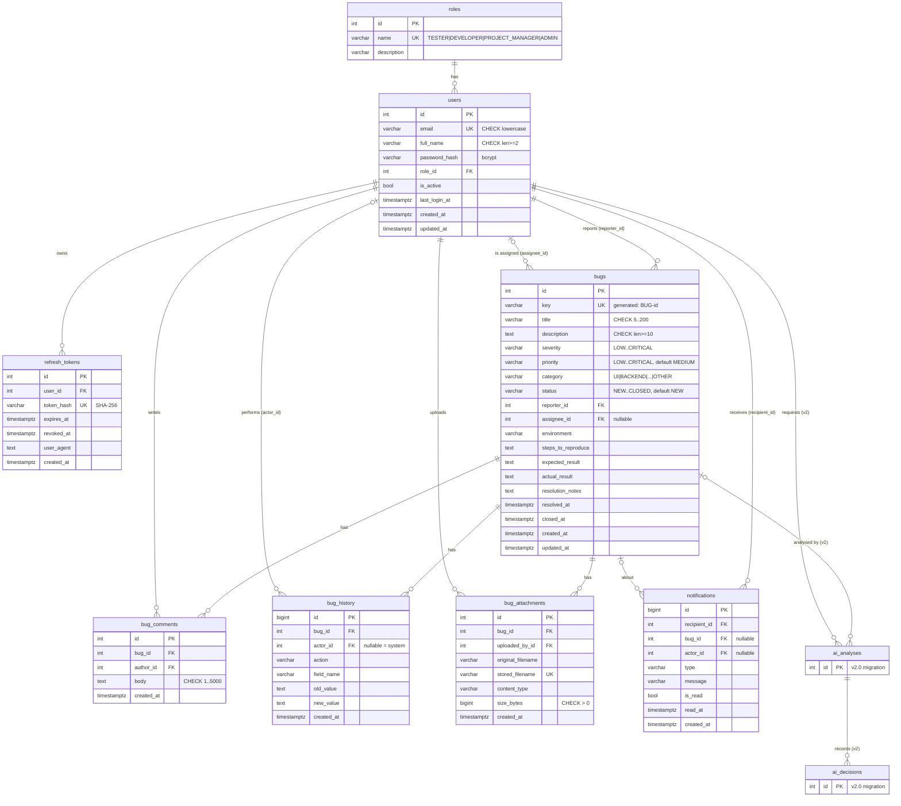

# 05 — Database Design

PostgreSQL 16 · SQLAlchemy 2.1 models in `backend/app/models/` · Alembic migrations in `backend/alembic/versions/`.

## ER diagram



The `ai_analyses` and `ai_decisions` tables are added by a separate v2.0 migration in Phase 9, so the migration history mirrors the release history.

## Normalisation

The schema is in **3NF**. Roles are a lookup table (no repeated role strings on users). Comments, history, attachments and notifications are separate child tables, not repeating columns. The only derived column is `bugs.key`, a PostgreSQL **stored generated column** (`'BUG-' || id`) that the database maintains, so it can't drift from `id`.

## Constraints

| Kind | Where | Purpose |
|---|---|---|
| Enum CHECKs | `roles.name`, `bugs.severity/priority/category/status`, `bug_history.action`, `notifications.type` | Enums stored as VARCHAR + named CHECK (easier to extend than native PG enums) |
| `ck_users_email_lowercase` | users | Case-insensitive uniqueness (service lower-cases input) |
| `ck_bugs_title_length`, `ck_bugs_description_min_length` | bugs | Mirrors API validation |
| `ck_bugs_active_work_requires_assignee` | bugs | IN_PROGRESS / RESOLVED must have an assignee |
| `ck_bugs_resolution_requires_notes` | bugs | RESOLVED / CLOSED must document the fix |
| `ck_bugs_closed_requires_closed_at` | bugs | Lifecycle timestamp integrity |
| `ck_bug_comments_body_length`, `ck_bug_attachments_size_positive` | children | Data sanity |

The workflow CHECKs are **defence in depth**. The service layer enforces the full transition rules and returns friendly 409 errors. The database guarantees that even a buggy code path can't persist an impossible state.

## Foreign-key delete behaviour

| FK | ON DELETE | Why |
|---|---|---|
| users → roles | RESTRICT | Roles are fixed reference data |
| bugs → users (reporter, assignee) | RESTRICT | Users are deactivated, never deleted |
| comments/history/attachments → bugs | CASCADE | Children have no meaning without their bug |
| comments/history/attachments → users | RESTRICT | Preserve audit authorship |
| notifications → users (recipient) | CASCADE | Personal inbox |
| notifications → users (actor) | SET NULL | Message still meaningful |
| refresh_tokens → users | CASCADE | Session data |

## Indexes

| Index | Supports |
|---|---|
| `ix_bugs_status`, `_severity`, `_priority`, `_category`, `_assignee_id`, `_reporter_id` | Single-field filters |
| `ix_bugs_assignee_id_status` | "My open bugs", workload per developer |
| `ix_bugs_status_created_at` | Dashboard trends, date-range filters |
| `ix_bugs_title_trgm`, `ix_bugs_description_trgm` (GIN, `pg_trgm`) | Keyword search with `ILIKE '%term%'` (verified by an EXPLAIN test) |
| `ix_bug_history_bug_id_created_at`, `ix_bug_comments_bug_id_created_at` | Bug detail timelines |
| `ix_bug_history_created_at` | Recent-activity feed |
| `ix_notifications_recipient_id_is_read_created_at` | Unread badge and inbox |
| `ix_refresh_tokens_user_id_expires_at` | Token revocation / cleanup |

## Migrations

| Revision | Description |
|---|---|
| `cb1fd34d2a60` | v1 initial schema: `pg_trgm` extension, 8 tables, seeded roles |

```bash
cd backend
alembic upgrade head          # apply
alembic downgrade -1          # roll back one revision
alembic revision --autogenerate -m "describe change"   # then review the generated file by hand
alembic check                 # fails if models and migrations have drifted
```

Each test run rebuilds the test database by running **upgrade → downgrade → upgrade**, and includes a test asserting the models and migrations are in sync.
