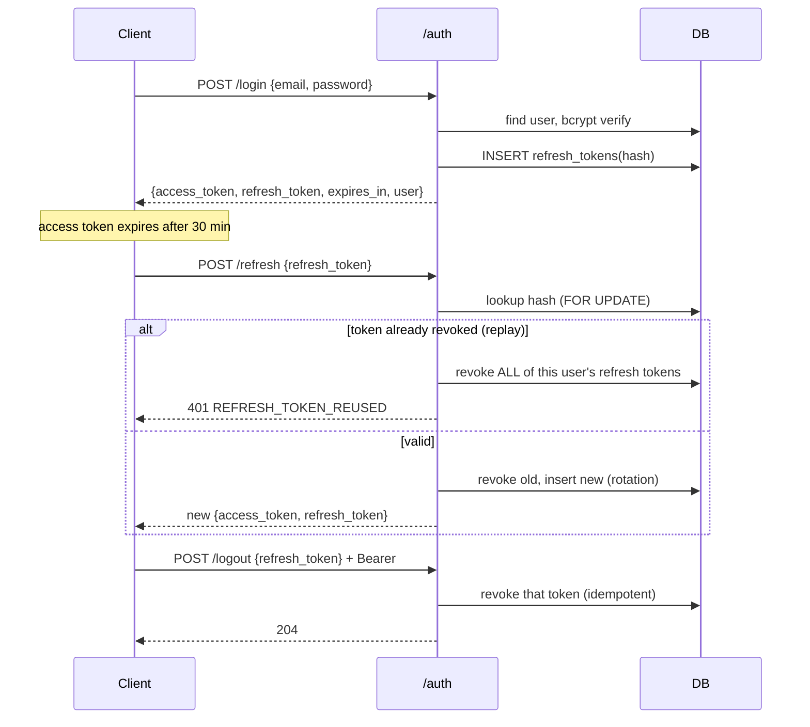

# 06 — Authentication & Role-Based Access Control

Implements FR-AUTH-1..5 and FR-USER-1..2.

## Token model

| Token | Format | Lifetime | Stored server-side | Purpose |
|---|---|---|---|---|
| Access | JWT (HS256), claims `sub, type, iss, iat, exp, jti` | 30 min (`JWT_ACCESS_TOKEN_MINUTES`) | No | `Authorization: Bearer …` on every API call |
| Refresh | Opaque 64-char random string | 7 days (`JWT_REFRESH_TOKEN_DAYS`) | **SHA-256 hash only** in `refresh_tokens` | Obtain a new token pair; revocable |

**The access token carries no role.** Each request reloads the user from the database, so changing a user's role or deactivating them **takes effect on the next request**, even with an unexpired token.

### Flow



## Security controls

| Threat | Control | Test(s) |
|---|---|---|
| Password theft from DB | bcrypt (cost 12 in production), unique salt per hash | `test_fr_auth_4_*`, `test_register_stores_bcrypt_hash` |
| bcrypt 72-byte truncation | Passwords over 72 bytes are rejected, not silently truncated | `test_password_over_72_bytes_*`, boundary tests |
| Weak passwords | ≥ 8 chars, at least one letter and one digit | `test_register_rejects_weak_passwords` |
| Account enumeration | Identical 401 for unknown email and wrong password; a dummy bcrypt check equalises timing; "deactivated" is revealed only after a correct password | `test_login_wrong_password_and_unknown_email_are_indistinguishable`, `..._reveals_nothing` |
| Brute force | Sliding-window limit per IP per auth endpoint (`AUTH_RATE_LIMIT_PER_MINUTE`, default 10) → 429 + `Retry-After` | `test_login_rate_limited_after_threshold` |
| Privilege escalation at signup | Role field ignored; self-registration is always TESTER | `test_register_ignores_client_supplied_role` |
| Mass assignment on profile | `PATCH /users/me` forbids unknown fields (422) | `test_update_me_rejects_invalid_or_extra_fields` |
| Forged / tampered JWT | Signature verified; algorithm pinned (blocks `alg: none`); issuer and all claims required | `test_tampered_*`, `test_alg_none_*`, `test_wrong_claims_rejected` |
| Stolen refresh token | Single-use rotation; replaying a used token revokes the whole session family | `test_refresh_token_reuse_revokes_all_sessions` |
| Refresh-token DB leak | Only SHA-256 hashes stored | `test_login_records_last_login_and_stores_only_refresh_hash` |
| Deactivated user keeps access | `is_active` checked on every request; refresh tokens revoked on deactivation | `test_deactivation_invalidates_existing_access_token_immediately` |
| Password change on a compromised device | Changing the password revokes all refresh tokens | `test_change_password_success_and_old_password_stops_working` |
| Admin locks themself out | Admins can't change their own role or deactivate themselves | `test_admin_cannot_*` |
| Secrets in logs | Logger redacts password/token keys; verified live: no passwords or tokens in server logs | `test_json_formatter_redacts_*` |
| Weak production secret | App refuses to start in production with the default or a short `JWT_SECRET_KEY` | `test_production_rejects_default_or_weak_jwt_secret` |

## RBAC design

Two layers:

1. **Role capabilities** — `app/services/permissions.py` maps each role to a set of capabilities (the permission matrix from the requirements). Routes use `require_capability(...)` or `require_roles(...)`.
2. **Resource ownership** (Phase 4) — "own bug" / "assigned bug" checks in the bug service, after the capability check.

`tests/unit/test_permissions.py` re-states the matrix from the requirements document independently and checks all 64 role × capability combinations.

`GET /users/me` returns the user's `capabilities` list so the frontend can hide actions. The backend still enforces every rule.

## Endpoints

| Method | Path | Access | Success | Errors |
|---|---|---|---|---|
| POST | `/api/v1/auth/register` | public, rate-limited | 201 `UserOut` | 409 `EMAIL_TAKEN`, 422, 429 |
| POST | `/api/v1/auth/login` | public, rate-limited | 200 `TokenResponse` | 401 `INVALID_CREDENTIALS`, 403 `ACCOUNT_DISABLED`, 422, 429 |
| POST | `/api/v1/auth/refresh` | refresh token, rate-limited | 200 `TokenResponse` | 401 `INVALID_REFRESH_TOKEN` / `REFRESH_TOKEN_EXPIRED` / `REFRESH_TOKEN_REUSED` / `ACCOUNT_DISABLED` |
| POST | `/api/v1/auth/logout` | authenticated | 204 | 401 |
| GET | `/api/v1/users/me` | authenticated | 200 `CurrentUserOut` (+ capabilities) | 401 |
| PATCH | `/api/v1/users/me` | authenticated | 200 | 422 |
| POST | `/api/v1/users/me/password` | authenticated | 204 | 422 `INVALID_CURRENT_PASSWORD` / `PASSWORD_REUSED` |
| GET | `/api/v1/users/developers` | PM, Admin | 200 `UserSummary[]` (active developers) | 401, 403 |
| GET | `/api/v1/users?q=&role=&is_active=&page=&page_size=` | Admin | 200 `Page[UserOut]` | 401, 403, 422 |
| GET | `/api/v1/users/{id}` | Admin | 200 | 401, 403, 404 |
| PATCH | `/api/v1/users/{id}/role` | Admin | 200 | 403 `SELF_MODIFICATION`, 404, 422 |
| PATCH | `/api/v1/users/{id}/status` | Admin | 200 | 403 `SELF_MODIFICATION`, 404 |

## Bootstrapping the first administrator

```bash
# in backend/.env (or the environment)
ADMIN_EMAIL=admin@yourcompany.com
ADMIN_PASSWORD=<strong password>
ADMIN_FULL_NAME=System Administrator

python -m scripts.seed_admin   # idempotent: created | promoted | unchanged
```

## Known limitations (accepted for scope)

- The rate limiter is in-process. With multiple backend replicas it should move to Redis.
- Refresh tokens are returned in the JSON body. Storing them in an httpOnly cookie is a hardening option for Phase 6.
- No email verification or password reset by email (no mail infrastructure in scope).
