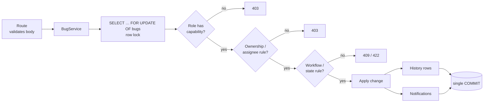

# 07 — Bug Management (v1.0 core)

Implements FR-BUG-1..4, FR-CMT-1, FR-HIST-1, FR-SRCH-1, FR-DASH-1, FR-NOTIF-1..2.

## How a change flows through the backend



A change, its audit rows and its notifications are committed together or not at all. The row lock serialises concurrent edits: in the live test, two simultaneous "resolve" requests on two server workers returned 200 and 409, and exactly one history entry was written.

## Lifecycle error semantics

| Situation | HTTP | `error.code` |
|---|---|---|
| Transition not in the lifecycle (incl. same status) | 409 | `INVALID_TRANSITION` (+ `details.allowed_targets` for this user) |
| Edge exists, but the role may not use it | 403 | `TRANSITION_NOT_PERMITTED` |
| Edge needs an assignee and the bug has none | 409 | `ASSIGNEE_REQUIRED` |
| Assignee-only edge, actor is a different developer | 403 | `NOT_ASSIGNEE` |
| Missing / blank resolution notes or reopen reason | 422 | `RESOLUTION_NOTES_REQUIRED` / `REASON_REQUIRED` |
| Role has no transition capability at all (Admin) | 403 | `FORBIDDEN` |

`GET /bugs/{id}/allowed-transitions` returns exactly the transitions the current user can perform now, with flags for which text fields are required. The UI builds its action menu from this endpoint and never hard-codes the rules.

### Side effects

| Transition | Effect |
|---|---|
| → RESOLVED | `resolution_notes` saved (change audited), `resolved_at` = now |
| → CLOSED | `closed_at` = now |
| → REOPENED | `resolved_at`, `closed_at` cleared; previous fix notes kept; reason saved as comment `Reopened: …` |

## Editing rules

| Actor | May edit | When |
|---|---|---|
| Project Manager | any bug | any status except CLOSED |
| Tester | only bugs they reported | NEW, OPEN, REOPENED |
| Developer, Admin | — | — |

- Priority (`PUT /bugs/{id}/priority`) and assignee (`PUT /bugs/{id}/assignee`) are PM-only and blocked on CLOSED bugs.
- An assignee must be an **active DEVELOPER**. A bug that is IN_PROGRESS or RESOLVED can be **reassigned** but not **unassigned**.
- Unknown fields, `status`, `priority`, `assignee_id` or explicit `null`s in `PATCH /bugs/{id}` → 422.
- Each changed field writes one history row with old and new value. Identical values write nothing.

## Notifications

| Event | Recipients (actor and inactive users always excluded) | Type |
|---|---|---|
| Assigned | new assignee; previous assignee ("unassigned you") | `BUG_ASSIGNED` |
| Status change | reporter, assignee | `STATUS_CHANGED` |
| Reopened | assignee, reporter, all project managers | `BUG_REOPENED` |
| Comment | reporter, assignee | `COMMENT_ADDED` |

## Search

`GET /bugs` filters can be combined. Repeat a parameter to match any of several values (`status=OPEN&status=REOPENED`).

| Parameter | Notes |
|---|---|
| `status`, `severity`, `priority`, `category` | repeatable |
| `assignee_id`, `assigned_to_me`, `unassigned` | |
| `reporter_id`, `reported_by_me` | |
| `created_from`, `created_to` | inclusive dates (UTC); reversed range → 422 `INVALID_DATE_RANGE` |
| `q` | case-insensitive in title or description, using the trigram index; `%` and `_` are literal characters; `BUG-12` / `12` also match by id |
| `sort` | `created_at` (default), `updated_at`, `priority`, `severity` (business rank, not alphabetical), `status` (lifecycle order), `title`, `id` |
| `order`, `page`, `page_size` (≤ 100) | |

## Attachments

- Allowed: png, jpg/jpeg, gif, webp, pdf, txt, log, json, zip. Anything else → 415.
- The **content type is set by the server** from the extension. The client's value is ignored.
- The first bytes must match the format (PNG/JPEG/GIF/WEBP/PDF/ZIP signatures; text files may not contain NUL bytes) → 415 otherwise.
- Size limit `MAX_UPLOAD_MB` (default 10), enforced while streaming → 413. Empty file → 422.
- Stored as `<UPLOAD_DIR>/<bug_id>/<random>.ext`. The original name is sanitised for display only (handles `/`, `\` and control characters).
- Downloads are always sent with `Content-Disposition: attachment`, `X-Content-Type-Options: nosniff` and `Cache-Control: private, no-store`.
- Who can upload: Tester and PM on any bug; Developer only on bugs assigned to them.

## Dashboard & reports

| Endpoint | Roles | Content |
|---|---|---|
| `/dashboard/summary` | all | totals by status, open, critical open, unassigned, open by severity/priority/category, *my* assigned and reported |
| `/dashboard/trends?days=1..365` | all | per-day created / resolved / closed, zero-filled. Resolved/closed come from the audit log, so a later reopen doesn't erase the day it was resolved |
| `/dashboard/activity?limit=1..100` | all | newest audit events with bug key, title and actor |
| `/dashboard/workload` | PM, Admin | per active developer: open, in progress, reopened, resolved, active total |
| `/dashboard/reports` | PM, Admin | closure rate, average hours to resolve, reopen rate, per-category and per-severity breakdowns |

## Demo data

```bash
cd backend
python -m scripts.seed_demo            # refuses if bugs already exist
python -m scripts.seed_demo --reset    # wipe bugs and reseed (refused when APP_ENV=production)
```

This creates 6 demo users (`priya.patel` PM; `tina.torres`, `sam.okafor` testers; `raj.mehta`, `lena.fischer`, `marco.rossi` developers; all `@demo.bugtrackr.dev`, password `Demo12345`). It also creates 36 bugs, driven through the real service layer and spread over 30 days.
