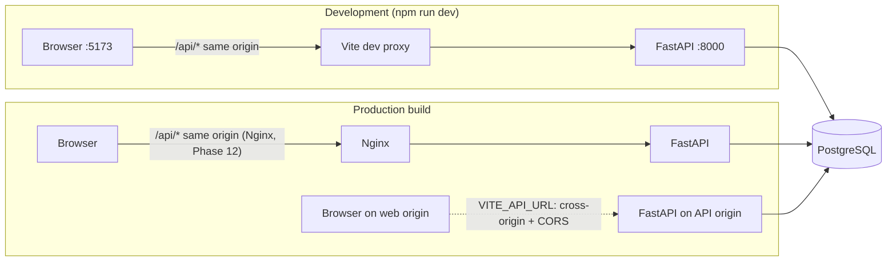
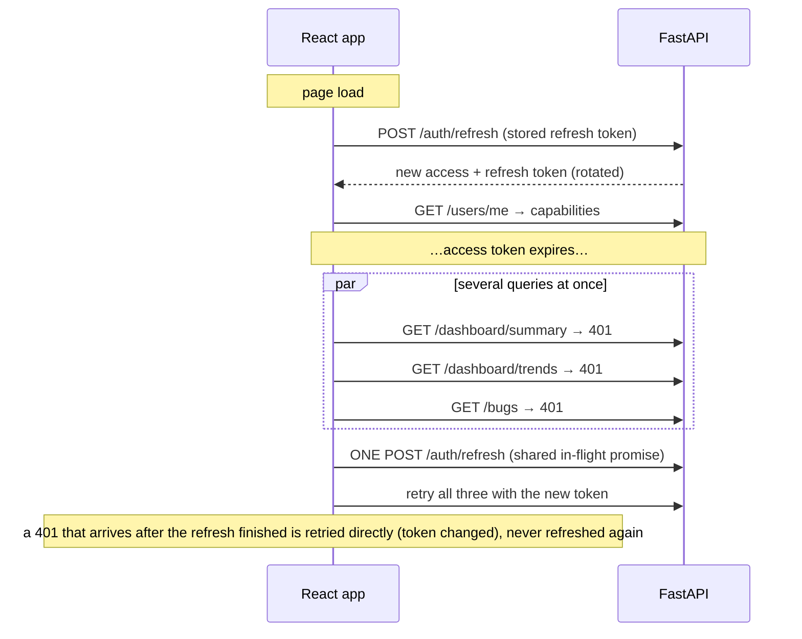

# 09 — Integration: Frontend, Backend and Database

## How the pieces connect



| Setting | Where | Purpose |
|---|---|---|
| `VITE_BACKEND_URL` | frontend dev server | Where the dev proxy forwards `/api` (default `http://localhost:8000`) |
| `VITE_API_URL` | frontend **build** | Absolute API base for a separately hosted API, e.g. `https://api.example.com/api/v1`. Empty means same origin (`/api/v1`) |
| `CORS_ORIGINS` | backend | Comma-separated list of browser origins allowed to call the API cross-origin |
| `REFRESH_RATE_LIMIT_PER_MINUTE` | backend | Separate, looser limit for session refresh (see P5-1) |

Attachment `download_url`s are returned as API paths and re-based onto `VITE_API_URL` by the client, so downloads work in both setups. This is verified by a test.

## Running everything locally

```bash
./scripts/dev.sh          # migrate, seed admin, start API :8000 + web :5173
./scripts/dev.sh --seed   # same, plus demo team and 36 bugs (wipes existing bugs)
```

## Session lifecycle (verified end to end)



| Situation | Behaviour | Test |
|---|---|---|
| Many requests fail at the same time with 401 | Exactly one refresh, all retried | `session.spec › expired access token…` |
| Refresh rejected (401, e.g. user deactivated) | Signed out → `/login`, then back to the same page after sign-in | `session.spec › a deactivated user…` |
| Refresh rate-limited / 5xx / offline | Token kept; the next attempt restores the session | `session.spec › a rate-limited session restore…` |
| Deep link opened while signed out | Returned there after sign-in | `session.spec › opening a deep link…` |
| Sign out | Server revokes the refresh token; the browser copy is cleared | `session.spec › signing out revokes…` |
| Role changed by admin | Applies on the next request (role isn't stored in the token) | `session.spec › a new account…` |
| API unreachable | "Cannot reach the server" with Try again; recovers | `session.spec › backend outage…` |

## Integration test suite (`e2e/`)

Playwright + TypeScript with Page Objects (`e2e/pages`) and fixtures (`e2e/fixtures`). The suite starts its **own isolated stack**:

| Component | Port | Notes |
|---|---|---|
| API | 8100 | Database `bugtracker_e2e` (never the dev DB); relaxed rate limits so many sign-ins don't trip brute-force protection |
| Web, dev server | 5174 | Project `integration` |
| Web, production build | 4174 | Project `prod-build`; built with `VITE_API_URL`, calls the API cross-origin |

`global-setup.ts` runs the Alembic migrations on the e2e database and loads the demo team, so every run starts from the same state. Tests create their own uniquely named data, never depend on each other, and fail automatically if the browser logs an uncaught error or the API returns a 5xx (the `health` fixture).

**Fast sign-in fixture:** `signInAs(page, user)` gets a refresh token from the API and places it in `localStorage` before the app boots. The app then restores the session through its real reload path. The sign-in form itself is covered by its own tests.

```bash
cd e2e
npm install
npx playwright install chromium          # or set CHROME_PATH=/path/to/chrome
createdb -O bugtracker bugtracker_e2e      # once
npm test                                   # both projects
npm run report                             # HTML report
```
