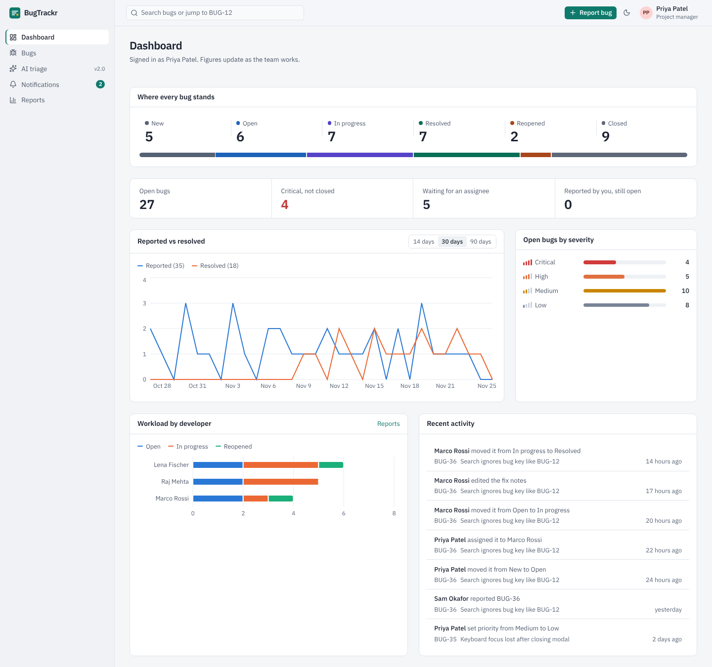

# BugTrackr v1.0.0 — Release Notes

**Released:** 2026-11-24 · **Tag:** `v1.0.0` · **Scope:** complete manual defect management (the AI features follow in v2.0)

## Highlights

- **A full defect workflow for four roles.** Testers report and verify, project managers triage, prioritise and assign, developers fix and document, and administrators manage accounts. The backend enforces every rule; the interface only offers what each person is allowed to do.
- **A lifecycle you can see.** The dashboard's lifecycle rail shows where every bug stands, and each bug's page shows where it is and what can happen next.
- **Nothing is lost.** Every change is recorded with who made it, the old and new values, and when. Bugs are never deleted.
- **Built to be trusted.** 1,218 automated tests across seven layers, 99% backend coverage, 100% of API operations exercised against the published contract, and zero serious accessibility violations.

## What's included

| Area | Capabilities |
|---|---|
| Accounts | Register, sign in/out, profile, password change, session restore across reloads and tabs |
| Roles | Tester, Developer, Project manager, Administrator (permission matrix in `docs/01-requirements-analysis.md` §3) |
| Bugs | Report, edit (role and status rules), priority, assignment, 8 lifecycle transitions with fix notes and reopen reasons |
| Collaboration | Comments, attachments (images, PDF, logs, JSON, ZIP; 10 MB), complete audit history |
| Search | 7 filter types, keyword or `BUG-12` search, sorting by business rank, pagination, shareable links |
| Notifications | Assignment, status change, comment, reopen; unread badge; mark read / all read |
| Insight | Dashboard (lifecycle rail, key figures, trends, severity, workload, activity) and reports (closure rate, time to resolve, reopen rate) |
| Administration | Search users, change roles, deactivate/reactivate (takes effect immediately) |
| Interface | 12 pages, light/dark/system themes, responsive, keyboard accessible, WCAG 2.1 AA |
| API | 37 REST operations, Swagger UI at `/docs`, documented error envelope, health and readiness probes |

## Quality summary

| Suite | Tests | Result |
|---|---:|---|
| Backend: unit, PostgreSQL integration, API | 988 | ✅ all pass, 99% coverage |
| Frontend unit (Vitest) | 49 | ✅ |
| Black-box API + OpenAPI contract | 99 | ✅ 37/37 operations |
| UI functional, integration, production build | 67 | ✅ |
| Accessibility (axe, WCAG 2.1 AA, both themes) | 9 | ✅ 0 serious/critical |
| Visual regression | 6 | ✅ |
| **Total** | **1,218** | **✅ 0 failures, 0 flaky** |

Full details: [`v1.0-test-report.md`](../test-reports/v1.0-test-report.md) (Phase 7 campaign) and [`v1.0-release-regression.md`](../test-reports/v1.0-release-regression.md) (release-branch gate).

## Defects fixed before release

The defect log has 28 entries across Phases 2–8: 21 product defects (1 High, 8 Medium, 12 Low) and 7 test or infrastructure issues. None remain open; each fix is guarded by a test. Notable ones:

| ID | Fixed |
|---|---|
| P5-1 (High) | Page reloads could sign users out once the shared login rate limit was reached |
| P6-1 | Signing in now returns you to the page you were trying to open |
| P7-1 | The published API contract now matches the real error responses |
| P7-2 | Signing out no longer triggers theft detection that ended your other sessions |
| P7-4 | Text and badge colours now meet WCAG AA contrast in both themes |

## Upgrade and installation

This is the first release, so there is nothing to migrate from. Fresh installation: see the [README](../../README.md#getting-started). The database schema is created by `alembic upgrade head` (revision `cb1fd34d2a60`).

## Known limitations

- Rate limiting is in-process (one backend instance). Use Redis-backed limits for multiple replicas.
- Refresh tokens are stored in `localStorage`; an httpOnly-cookie variant is a hardening option.
- Notifications are in-app only (no email). There are no multiple projects or workspaces.
- Visual-regression baselines are tied to platform and browser; regenerate them on the CI image.
- Docker, CI/CD and the AWS guide arrive with v2.0 (Phase 12).
